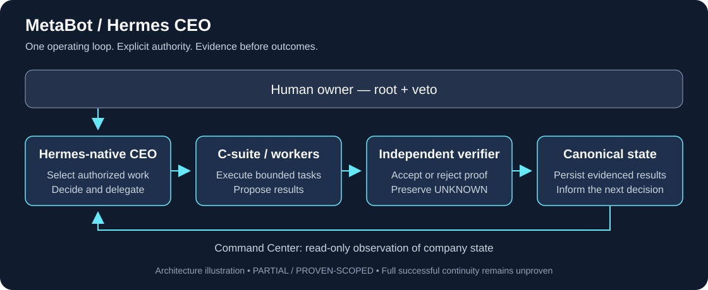

# Hermes Autonomous Company

**MetaBot: one Hermes-native AI CEO, a governed executive team, and an evidence trail for what the company actually did.**

The human owner retains **root + veto**. The CEO selects authorized work; executives execute; independent verification determines what can be recorded as an outcome.

**Start here:** [60-second evidence walkthrough](DEMO.md) · [Current proof and limits](CURRENT_STATE.md) · [Claim-by-claim evidence](PUBLIC_EVIDENCE_INDEX.md)



### What you can inspect today

| Observed in the preserved October 12 evidence | Proof boundary |
|---|---|
| Ordinary scheduled wake → real CEO inference → governed CTO delegation → isolated executive session | The CTO repair failed; launch is not successful completion. |
| Terminal failure → CEO wake in 2 seconds → failure disposition | Event-driven failure continuation, within that observation window. |
| CFO and CMO execution overlapped for **213.47 seconds** | That pair of native profiles/jobs/sessions, not universal concurrency. |
| Three follow-ups: **SEND ACCEPTED + SENT-FOLDER VERIFIED** | Matching pipeline updates and zero duplicates in the bounded run; delivery, replies, customers and cash are not established. |

**Continuous operation: PARTIAL / PROVEN-SCOPED.** The complete successful executive → verification → reconciliation → next economic work chain remains unproven. Public revenue and cash measurements remain **UNKNOWN** unless authoritatively measured. These are dated observations, not a live health claim.

Built on [Nous Research's Hermes Agent](https://github.com/NousResearch/hermes-agent). This public repository contains sanitized evidence and architecture; implementation remains private.

For technical review, start with [the walkthrough](DEMO.md). For pilots, research support or infrastructure sponsorship, see [SPONSORSHIP.md](SPONSORSHIP.md) and [INVESTORS.md](INVESTORS.md).

---

This repository documents an operating experiment in **human-governed autonomous companies**: one AI CEO coordinates an executive layer and digital workforce to pursue real business objectives while the human owner retains root authority, veto power and reserved decisions.

> **Core v1 status:** BUILT / PRODUCTION  
> **Public scope:** facts, architecture, product, evidence, failures, corrections, business model and roadmap  
> **Not published here:** source code, credentials, private customer/prospect data, banking details, security-sensitive implementation paths or raw private transcripts

## What is being built

MetaBot Solutions is developing an **Autonomous Company OS**: a governed operating architecture for AI executives and digital workers that can observe company state, reason, delegate, execute within authority, verify results, persist evidence, recover from faults and continue operating.

The system is intentionally model-independent. The language model supplies reasoning; the operating system supplies company state, authority, workflows, evidence, persistence and controls.

The operating pattern is:

```text
Human owner (root + veto)
        ↓
AI CEO
        ↓
C-suite executives
        ↓
Digital workers / tools / channels
        ↓
Verification + evidence + persisted company state
        ↺
```

## Why this repository exists

Most AI-agent demonstrations show a successful interaction. This project is documenting a harder question:

**Can an AI-led company operate continuously, economically and safely under explicit human authority — including failures, repairs, evidence and commercial execution?**

We publish the facts because credibility requires more than demos.

This repository therefore preserves:

- what has been demonstrated;
- what remains unproven;
- failures and corrections;
- commercial progress;
- governance boundaries;
- product and pricing direction;
- sponsorship and investment opportunities;
- the path from digital workers to a full Autonomous Company OS.

## Evidence language

We deliberately distinguish different levels of proof.

For example:

```text
PROVIDER ACCEPTED
≠ RECIPIENT DELIVERED
≠ RECIPIENT READ
≠ HUMAN REPLY
≠ SIGNED CUSTOMER
≠ CASH COLLECTED
```

A claim is not upgraded merely because the next state would be convenient.

## Current public status

The [October 14 economic-coverage and recovery addendum](evidence/ECONOMIC_COVERAGE_AND_RECOVERY_2026-10-14.md) adds scoped social execution, CEO-selected sponsorship preparation and scheduled-path reboot continuity. Fresh post-Hermes-restart reconciliation progressed, but full restart recovery remains open. The overall classification remains **PARTIAL / PROVEN-SCOPED**.

The following preserves the 2026-10-13 public reconciliation of operating evidence:

- Core v1 remains **BUILT / PRODUCTION**.
- Human owner remains **root + veto**, not routine dispatcher or option selector; execution improvements cannot expand protected authority.
- One canonical Hermes-native CEO loop remains the company operating loop.
- A natural scheduled CEO wake has now demonstrated real CEO inference, work selection, governed executive delegation and isolated CTO-home execution on the ordinary production path.
- The earlier CTO attempt remains failed. Later evidence proves real event-driven failure continuation and CFO/CMO concurrency; full continuous operation remains **PARTIAL / PROVEN-SCOPED**, not fully proven.
- The follow-up routing repair passed independent acceptance; three bounded follow-up sends were **SEND ACCEPTED + SENT-FOLDER VERIFIED**, with matching pipeline updates and no duplicate sends. This does not prove delivery, reading, replies, customers, revenue or cash.
- The commercial mission is now explicitly **multi-engine**: marketplace/Fiverr fast cash, MetaCall services, MetaBot pilots/licensing, investors/acquirers, and sponsorship/resources.
- Recognized revenue and treasury state remain **UNKNOWN unless independently measured**; the public record does not convert missing measurement into $0.
- Real outbound commercial activity exists, but recipient delivery, signed-customer revenue and cash collection are not yet proven.
- Failures and corrections remain part of the public evidence trail rather than being rewritten as success.

See [CURRENT_STATE.md](CURRENT_STATE.md), [TRACTION.md](TRACTION.md) and [COMMERCIAL_OPERATING_STRATEGY.md](COMMERCIAL_OPERATING_STRATEGY.md).

## Continuous company direction

The intended end state is not a company that wakes every few hours.

It is a **continuous event-driven autonomous company** in which meaningful events wake the CEO immediately, independent C-suite lanes can work concurrently, and terminal executive results trigger verification/reconciliation/continuation. The two-hour schedule is watchdog/recovery only.

The system should be:

> **Always available, not always consuming inference.**

When authorized useful work exists, the company should keep moving. An empty event inbox alone does not justify idle: review eligible opportunities, due follow-ups, pipeline review, due discovery and economically useful capability repair. When those checks find nothing due or eligible, it may sleep cheaply until an event or watchdog wake occurs.

The existing loop has scoped production evidence; the priority is proactive economic execution and remaining acceptance, without new architecture layers. Successful executive completion → immediate event wake → independent verification → reconciliation/retirement → next economic work remains a proof requirement; later reconciled dashboard rows alone do not establish that chain.

See [CONTINUOUS_COMPANY_LOOP.md](CONTINUOUS_COMPANY_LOOP.md).

## Why this is an ambitious bet

The project is not trying to win by making a prettier chatbot.

The bet is that the next valuable layer above individual AI agents is a **governed autonomous economic operating system**: a system that can carry durable authority, company state, executive roles, tools, verification, recovery and commercial objectives across models and sessions.

The credible version of that idea must survive real failure.

That is why the public record deliberately preserves failed repairs, stale state, refused actions, unknown measurements and incorrect prior claims instead of polishing them away.

The target proof is stronger than agent orchestration:

```text
economic objective
→ authorized CEO decision
→ delegated executive work
→ real tool execution
→ independently verified outcome
→ durable company state
→ next autonomous decision
→ external economic result
```

If that loop becomes repeatable, the value is not the prompt or the model. The value is the operating system around them.

## Hermes Desktop / Agent OS surface

On October 12, 2026 the existing MetaBot Command Center was integrated into Hermes Desktop as a standalone local plugin surface named **METABOT COMPANY**.

The integration preserves the chosen architecture:

```text
Hermes runtime
= agent execution

AI-OS
= canonical company / governance / economic state

MetaBot Command Center
= read-only company projection

Hermes Desktop
= primary owner Agent OS shell
```

The company surface can correlate executive assignments with exact Hermes profiles, jobs, attempts and stored sessions, and can navigate between the company-level view and the owning Hermes session.

The integration does not create a second scheduler, second authority plane or second source of company truth.

A real ordinary CTO cycle was observed through dispatch, running activity and terminal failure with changing model/tool counters. The UI preserved the failure rather than promoting process completion to success.

That failed October 12 attempt remains historical evidence. Later event-driven failure continuation and CFO/CMO concurrency are proven within scope; full successful executive continuation and full 24/7 operation are not claimed.

## Product direction

The commercial product has evolved from individual AI agents into a hierarchy:

```text
MetaBot Autonomous Company OS
        ↓
Autonomous executive / C-suite layer
        ↓
Department workforces
        ↓
Specialized digital workers
        ↓
Integrations + governance + audit + human checkpoints
        ↓
Ongoing workforce operations
```

The historical product thesis remains:

> **Build Your Workforce — not Buy an AI Agent.**

See [PRODUCT.md](PRODUCT.md) and [product/PRICING.md](product/PRICING.md).

## Multi-engine commercial operating model

MetaBot / MetaCall is not relying on one commercial funnel.

The governed company operating system supports multiple parallel economic engines:

- **marketplace / fast-cash services** — including Fiverr-style service offers where current demand can be measured quickly;
- **MetaCall Solutions** — bookkeeping, QuickBooks, cleanup, reconciliation, reporting and CFO-support services;
- **MetaBot Solutions** — digital workforces, autonomous-company infrastructure, pilots, licensing, partnerships and strategic transactions;
- **investment / acquisition** — strategic investors, angels, venture capital, potential acquirers and licensing partners;
- **sponsorship / non-dilutive resources** — model credits, cloud/API credits, hardware, startup programs, grants and research partnerships.

The CEO is expected to allocate effort dynamically toward the highest expected economic value rather than treating every channel equally.

The strongest near-term proof is not another internal architecture milestone. It is externally verified economic progress: a paid order, cash received, a serious investor/acquirer meeting, diligence, a sponsor commitment, model credits, hardware/resources, or another measurable transaction advance.

See [COMMERCIAL_OPERATING_STRATEGY.md](COMMERCIAL_OPERATING_STRATEGY.md).

## Public evidence policy

The deeper build history remains private because it contains implementation detail and sensitive operational evidence. This public repository publishes sanitized, supportable facts derived from that record.

We do **not** publish:

- source code;
- API keys, tokens or secrets;
- private email addresses or prospect identities;
- banking identifiers;
- private correspondence;
- security-sensitive local paths;
- raw transcripts that may contain sensitive data.

See [SECURITY_AND_PRIVACY.md](SECURITY_AND_PRIVACY.md).

## For customers, sponsors, partners and investors

We are looking for aligned parties who want to help move autonomous-company technology from production proof toward commercial scale.

You can engage as a:

- **pilot customer** — deploy a digital workforce or governed autonomous workflow;
- **enterprise partner** — integrate the operating model into a real organization;
- **infrastructure/model sponsor** — provide inference, compute, API or hardware resources;
- **research/technical partner** — help test governance, safety, verification and human-AI collaboration;
- **strategic investor or acquirer** — support scale, licensing, distribution and enterprise value creation.

See [SPONSORSHIP.md](SPONSORSHIP.md), [INVESTORS.md](INVESTORS.md) and [ROADMAP.md](ROADMAP.md).

## Repository map

- [CURRENT_STATE.md](CURRENT_STATE.md) — latest public state
- [ARCHITECTURE.md](ARCHITECTURE.md) — operating architecture
- [GOVERNANCE.md](GOVERNANCE.md) — human authority and autonomous execution boundaries
- [PRODUCT.md](PRODUCT.md) — product hierarchy and customer value
- [BUSINESS_MODEL.md](BUSINESS_MODEL.md) — paths to revenue and enterprise value
- [COMMERCIAL_OPERATING_STRATEGY.md](COMMERCIAL_OPERATING_STRATEGY.md) — multi-engine revenue, capital and resource-acquisition operating model
- [CONTINUOUS_COMPANY_LOOP.md](CONTINUOUS_COMPANY_LOOP.md) — event-driven 24/7 CEO/C-suite operating model
- [TRACTION.md](TRACTION.md) — demonstrated commercial and operating progress
- [ROADMAP.md](ROADMAP.md) — next milestones
- [SPONSORSHIP.md](SPONSORSHIP.md) — sponsorship and infrastructure support
- [INVESTORS.md](INVESTORS.md) — investor / strategic-partner thesis
- [PUBLIC_EVIDENCE_INDEX.md](PUBLIC_EVIDENCE_INDEX.md) — claim/evidence map
- [INDUSTRY_LANDSCAPE_AND_COMPETITIVE_LEARNING.md](INDUSTRY_LANDSCAPE_AND_COMPETITIVE_LEARNING.md) — external benchmark, lessons and continuous-learning doctrine
- [case-study/FROM_AGENT_TO_AUTONOMOUS_COMPANY.md](case-study/FROM_AGENT_TO_AUTONOMOUS_COMPANY.md)
- [white-paper/AUTONOMOUS_COMPANY_OS.md](white-paper/AUTONOMOUS_COMPANY_OS.md)

## Important distinction

This is currently a **public evidence and architecture repository**, not a public source-code repository.

The software implementation remains private. No open-source software license is implied by publication of these documents.

---

**MetaBot Solutions — humans retain authority; AI expands execution capacity.**


## Continuous competitive learning

The project continuously studies serious autonomous-company systems, multi-agent research, agent control planes and production failure reports. Useful external lessons are tested against MetaBot's governance and evidence requirements before adoption. See [INDUSTRY_LANDSCAPE_AND_COMPETITIVE_LEARNING.md](INDUSTRY_LANDSCAPE_AND_COMPETITIVE_LEARNING.md).
