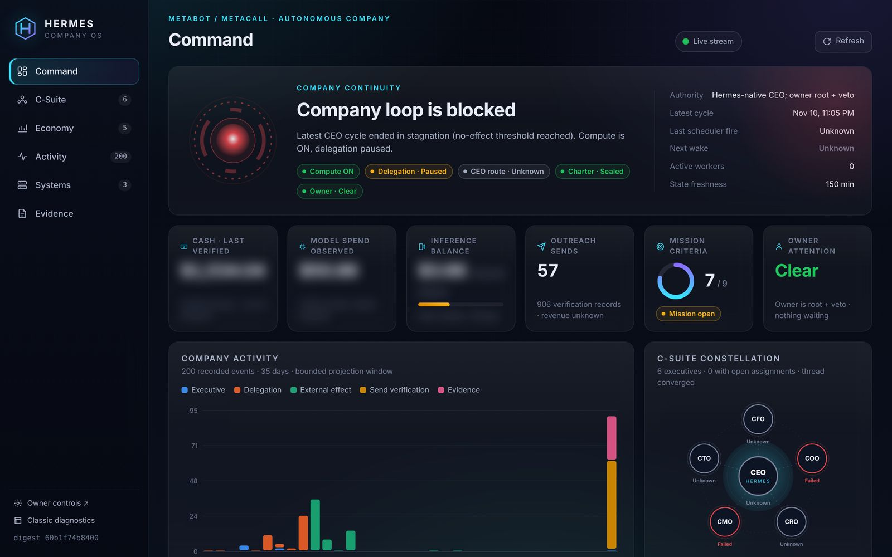

# Company audit and repair — November 13, 2026

**Scope.** A full read of the private runtime's own ledgers (CEO cycles, executive assignments, revenue lanes,
social ledger, owner controls) to answer one question: *why has the company not earned money, posted
consistently or cycled the way an autonomous company should?* Followed by owner-approved repairs.

**Status of the repairs: deployed, not yet verified live.** At the time of writing the owner's C-suite delegation
control was still paused, so no CEO cycle had yet run on the repaired code. Nothing below claims a new customer,
payment or revenue.

## What the evidence showed (Oct 15 – Nov 11)

| Measure | Value |
| --- | --- |
| CEO cycles recorded | 4,336 |
| Cycles ending `idle_refused` (no-effect threshold) | 2,856 (66%) |
| Cycles refused before starting (no authorised model route) | 797 |
| Cycles waiting on paused delegation | 392 |
| Cycles that completed | 3 |
| Executive assignments | 563 — 265 failed, 83 timed out |
| Executive results reported COMPLETE but rejected by the verifier | 168 |
| Recognised revenue | $0 |

## Root causes

1. **Idle-admission deadlock.** After two cycles with no verified effect the CEO was refused permission to
   idle, yet no work class was executable. Each refusal counted as another no-effect cycle, so the streak only
   grew (29 at the last cycle).
2. **Outreach required pre-verified buyer intent.** Researched contacts were classed as "not buyer demand",
   and the two public intent sources failed (one returned HTTP 403, the other is disallowed by robots policy).
   The send rule also stopped after the first wave by design, with no path to a second.
3. **No authorised model for the CEO.** A free-only policy approved no route; a paid route passed its
   qualification but was used for only a few hours before its 48-hour window closed.
4. **Executive work discarded on format.** The verifier rejected completed work for citation-format rules.
5. **Runtime fragility.** The company runs on a desktop PC: a 35-hour outage left a stale wake lock, and the
   cycle log had grown to 4.6 GB.

## Repairs (owner-approved)

| Change | Effect |
| --- | --- |
| Model follows the owner's Hermes model picker | All six roles use the OpenRouter model selected in Hermes; no expiry; spend bounded by the verified provider balance, no automatic top-ups |
| Growth generation | When nothing is executable the CEO issues one bounded research/drafting task per lane per day, then idles honestly until the next trigger |
| Governed daily outreach wave | One wave per day for the fixed-scope QuickBooks cleanup offer, only to recipients passing every existing qualification gate, inside the 25/day send cap, verified in the Sent folder |
| Research as a buyer source | The CRO's qualified research files replace the two dead public sources |
| Verifier policy | Evidence-format checks become recorded warnings; identity, integrity, scope and external-effect checks still fail closed |
| Social channels | Facebook, Instagram and LinkedIn for both brands; daily drafts queued and published per channel (LinkedIn pending the platform's app review) |
| Runtime cleanup | Large evidence logs rotate to an archive (nothing deleted); a reporting bug that hid publish refusals is fixed |
| Command Center | Rebuilt as a read-only dark operations dashboard (below) |

## What remains unproven

- That the repaired loop produces verified business effects once delegation is enabled.
- Any customer, payment or revenue.
- Instagram publishing permission on the page token, and LinkedIn app approval.
